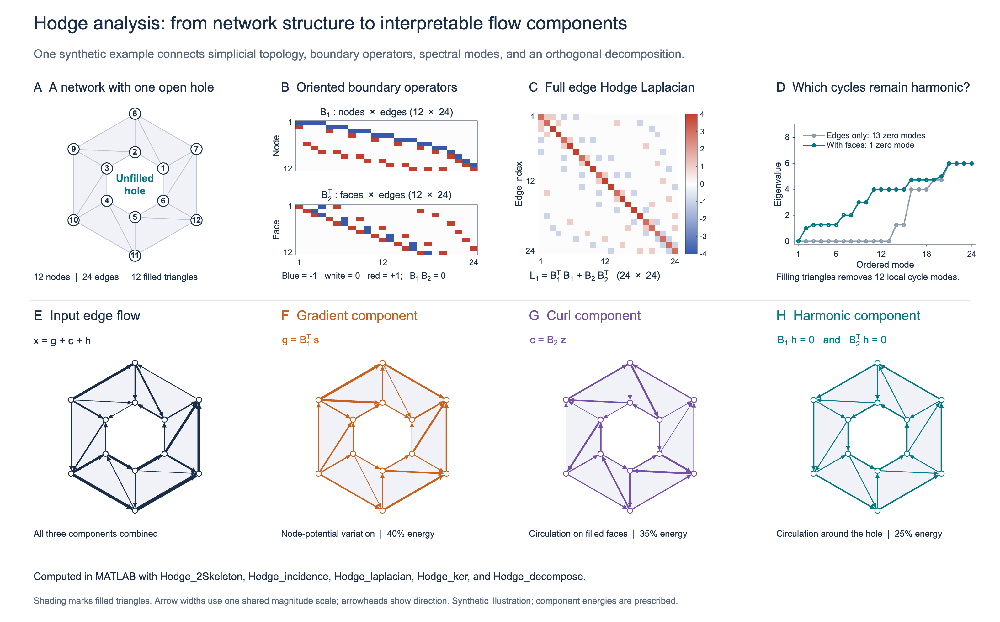

# Network Hodge Analysis of Brain Activity

**MATLAB tools for decomposing network flows and characterizing cycles with the Hodge Laplacian.**

Brain connectivity matrices describe relationships between pairs of regions. Hodge analysis connects these measurements to the organization of the whole network: variation explained by node potentials, circulation around filled triangular faces, and circulation associated with unfilled loops. This repository provides the computational methods, worked examples, and simulation scripts accompanying our studies of brain network topology and dynamics.



**One network, complementary views.** A–D connect a 12-node network to its boundary operators and spectrum. The graph alone has 13 independent cycles; including its 12 triangular faces leaves one harmonic mode around the open hole. E–H decompose the same edge flow into gradient, curl, and harmonic components. Shading indicates filled faces, and arrow widths share one magnitude scale. This deterministic synthetic illustration was generated in MATLAB using the repository's functions; its 40% / 35% / 25% component energies were prescribed for demonstration. [Figure methods and numerical checks](assets/readme/FIGURE.md) · [Reproduction script](assets/readme/generate_readme_figure.m)

## What the package can do

| Capability | Scientific use | Main functions / examples |
|---|---|---|
| Construct network complexes | Represent nodes, edges, and triangular interactions from a connectivity matrix. | [`Hodge_1Skeleton`](Hodge_1Skeleton.m), [`Hodge_2Skeleton`](Hodge_2Skeleton.m) |
| Build boundary operators and Laplacians | Relate network topology to an edge-space linear operator and its spectrum. | [`Hodge_incidence`](Hodge_incidence.m), [`Hodge_laplacian`](Hodge_laplacian.m), [`EXAMPLE.hodgelaplacian.m`](EXAMPLE.hodgelaplacian.m) |
| Separate network flows | Decompose an edge signal into gradient, curl, and harmonic components; optionally recover node and face potentials. | [`Hodge_decompose`](Hodge_decompose.m), [`Hodge_vec`](Hodge_vec.m) |
| Extract cycle representations | Obtain null-space modes and construct graph-cycle bases using a spanning tree and non-tree edges. | [`Hodge_ker`](Hodge_ker.m), [`Hodge_kCycle`](Hodge_kCycle.m) |
| Study differences between networks | Explore cycle-based group comparisons and permutation procedures in the accompanying research simulations. | [`SIMULATION_Anand.2022.TMI.m`](SIMULATION_Anand.2022.TMI.m), [`SIMULATION_Dakurah.2022.MICCAI.m`](SIMULATION_Dakurah.2022.MICCAI.m) |
| Visualize network structure and flow | Display directed networks and simplicial complexes for inspecting results. | [`graph_directed_plot`](graph_directed_plot.m), [`digraph_plot`](digraph_plot.m), [`PH_rips_display`](PH_rips_display.m) |

## Interpreting the decomposition

For a chosen simplicial complex, let $B_1$ be the node–edge boundary matrix and $B_2$ the edge–triangle boundary matrix. An edge-flow vector $x$ decomposes as

$$x = \underbrace{B_1^\top s}_{\text{gradient}} + \underbrace{B_2 z}_{\text{curl}} + \underbrace{h}_{\text{harmonic}}, \qquad L_1 = B_1^\top B_1 + B_2 B_2^\top.$$

- **Gradient:** differences in node potentials describe flow associated with sources and sinks.
- **Curl:** combinations of triangle boundaries describe local circulation around filled faces.
- **Harmonic:** the remaining flow satisfies $B_1h=0$ and $B_2^\top h=0$, capturing circulation associated with unfilled loops.

These components are orthogonal under the standard Euclidean inner product. Their interpretation depends on the selected edges and faces: filling a triangular cycle makes its circulation a curl component. In a graph with no filled faces, the curl component is zero and the harmonic subspace is the graph's cycle space.

## Quick start in MATLAB

Download or clone this repository, set its folder as the MATLAB current folder, and run the example below. It uses a five-node network with one filled triangle and one unfilled loop.

```matlab
addpath(pwd);

% Antisymmetric edge-flow matrix; zero diagonal.
Y = [ 0    1    1    0    0;
     -1    0    2    1.5  0;
     -1   -2    0    0    1.5;
      0   -1.5  0    0    0.5;
      0    0   -1.5 -0.5  0];

S = Hodge_2Skeleton(Y);
I = Hodge_incidence(S);
B = {I{2}, I{3}};                 % Node-edge and edge-triangle matrices.
x = Hodge_vec(Y);                % Edge order matches S{2}.
[g, c, h] = Hodge_decompose(x, B);

L1 = B{1}' * B{1} + B{2} * B{2}';
[U, lambda] = Hodge_ker(L1);      % Columns of U span the harmonic subspace.
fprintf('Reconstruction error: %.3g\n', norm(x - g - c - h));
fprintf('Number of harmonic modes: %d\n', size(U, 2));  % 1
```

**Boundary conventions.** `Hodge_incidence` returns $B_1$ and $B_2$ in cells 2 and 3; the current `Hodge_decompose` expects them in cells 1 and 2, so the example remaps them explicitly. `Hodge_laplacian(I)` computes the graph operator $B_1^\top B_1$; add $B_2B_2^\top$ as above when analyzing a complex with filled triangles. `Hodge_ker` uses an eigenvalue threshold of $10^{-5}$ to identify the kernel.

**Input conventions.** Use a zero diagonal and consistent edge orientation. `Hodge_2Skeleton` uses nonzero connectivity to define edges and fills every three-node clique. `Hodge_vec` retains nonzero upper-triangular entries. When comparing observations on a fixed network, align all edge vectors to the same edge list, including edges whose observed flow is zero.

The quick start and figure script were checked in **MATLAB R2026b** using core MATLAB. Some research simulations also require the **Statistics and Machine Learning Toolbox**. The original [Live Script](EXAMPLE-HodgeDecomposition.mlx) and [decomposition walkthrough](Example-HodgeDecomposition.m) provide additional context; some older walkthroughs reference companion helpers such as `PH_boundary` and `edgeflow2digraph` that are not standalone files in this repository. The quick start above uses the functions included here.

## Reproduce the figure

From the repository root:

```matlab
addpath(fullfile(pwd, 'assets', 'readme'));
generate_readme_figure;
```

The script creates the single eight-panel PNG in `assets/readme/`, writes numerical checks beside it, and saves the underlying arrays in `build/readme/figure-data.mat`. It checks the boundary identity, expected nullities, reconstruction, agreement with the known components, orthogonality, and harmonic constraints. These checks validate the illustrated examples; the paper-specific simulation studies are separate workflows.

## Publications and research examples

### Harmonic flows of brain networks

Chung, M.K., Maccotta, L., and Struck, A. (2026). **Counterfactual analysis of brain network dynamics.** IEEE International Symposium on Biomedical Imaging (ISBI), pp. 1–5. [Paper](chung.ISBI.2026.pdf)

### Hodge decomposition of brain networks

Anand, D.V., and Chung, M.K. (2024). **Hodge decomposition of brain networks.** ISBI. [Paper](anand.2024.ISBI.pdf) · [Poster](anand.2024.ISBI.poster.pdf)

Anand, D. Vijay, El-Yaagoubi, A.B., Ombao, H., and Chung, M.K. **Hodge-Decomposition of Functional Brain Networks.** Extended manuscript. [arXiv:2211.10542](https://arxiv.org/abs/2211.10542)

Examples: [MATLAB walkthrough](Example-HodgeDecomposition.m) · [Live Script](EXAMPLE-HodgeDecomposition.mlx)

### Hodge Laplacian of brain networks

**Disrupted Higher-Order Topology in OCD Brain Networks Revealed by Hodge Laplacian – an ENIGMA Study** (2026), ENIGMA OCD Working Group and collaborators. [OHBM abstract](OHBM_2026_ENIGMA-OCD.pdf) · [Preprint](https://doi.org/10.64898/2026.03.04.709586)

Anand, D.V., and Chung, M.K. (2023). **Hodge Laplacian of Brain Networks.** *IEEE Transactions on Medical Imaging*, 42:1563–1573. [Paper](anand.2023.pdf) · [arXiv:2110.14599](https://arxiv.org/abs/2110.14599) · [Worked example](EXAMPLE.hodgelaplacian.m) · [Simulation study](SIMULATION_Anand.2022.TMI.m)

Dakurah, S., Anand, D.V., Chen, Z., and Chung, M.K. (2022). **Modelling Cycles in Brain Networks with the Hodge Laplacian.** MICCAI, LNCS 13431. [Paper](dakurah.2022.MICCAI.pdf) · [Simulation study](SIMULATION_Dakurah.2022.MICCAI.m)

Please cite the relevant method paper when using these codes or examples.

## Credits and contact

(C) 2024 Vijay D. Anand and Moo K. Chung, University of Wisconsin–Madison.  
(C) 2022 Vijay D. Anand, S. Dakurah, Z. Chen, and Moo K. Chung, University of Wisconsin–Madison.

For code maintenance and support: [mkchung@wisc.edu](mailto:mkchung@wisc.edu).
